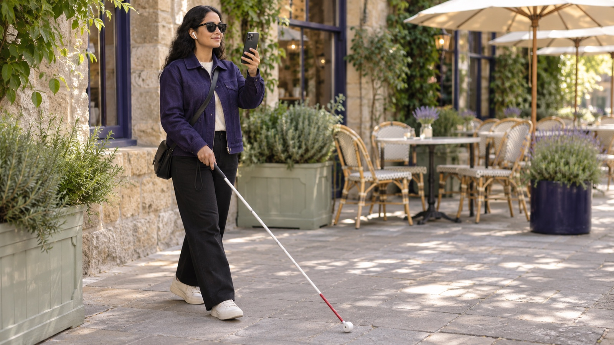
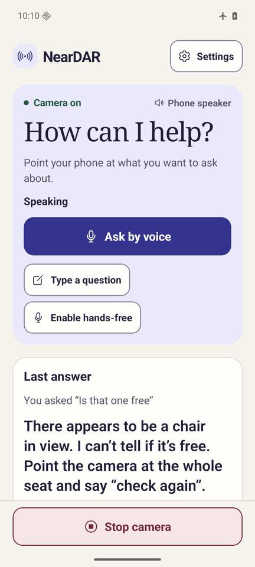
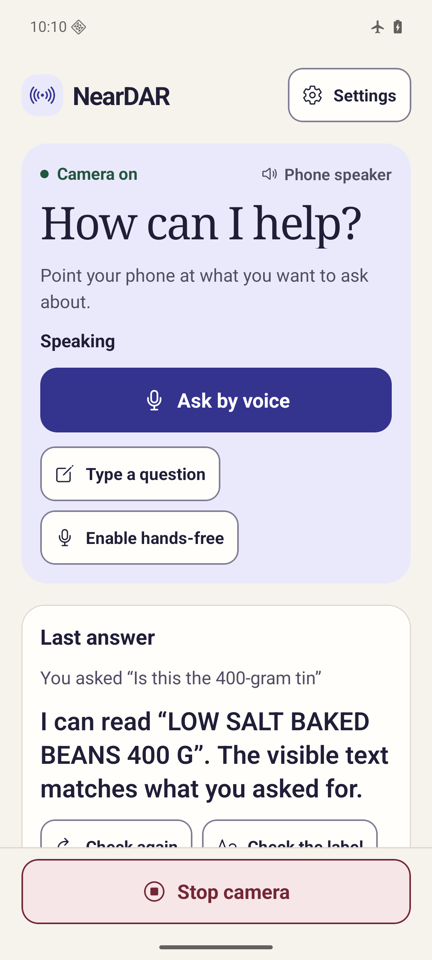
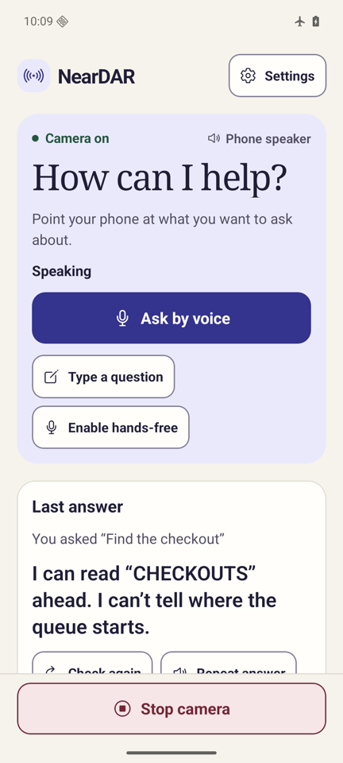

# NearDAR

**A camera companion for everyday errands, built for blind and low-vision people.**



Ask what’s nearby, look for a seat, verify a product label, or find a checkout sign. NearDAR uses the phone camera, offline text recognition, and a downloadable on-device vision model. Ask by voice or type, then hear what the app can make out from the current view.

[See NearDAR in action](#see-neardar-in-action) · [Build NearDAR](#build-neardar)

## See NearDAR in action

<table>
  <thead>
    <tr>
      <th>Find a seat</th>
      <th>Check a label</th>
      <th>Find checkout</th>
    </tr>
  </thead>
  <tbody>
    <tr>
      <td></td>
      <td></td>
      <td></td>
    </tr>
  </tbody>
</table>

These are Android emulator captures using camera fixtures with networking disabled. The opening image is an illustration of the intended use. [See the first-run setup screen](docs/images/first-run.png).

## What you can ask

- **“Help me find a seat.”** Take a fresh look with “Is that one free?” NearDAR distinguishes a visible chair from a seat with enough evidence to suggest availability.
- **“Is this the 400-gram tin?”** Find an item and hold its label close to confirm the name and details the camera can read.
- **“I need baked beans, oats, and milk.”** Start a session shopping list. Say “Next item” to look for it and “Cross that off” when you’ve got it.
- **“Find the checkout.”** Hear what the sign says and where it appears in the camera view.
- **“Where am I?”** Get an approximate location when your phone can provide one. Looking up an address can use the network.

## Development status

NearDAR is a development preview. Offline camera capture, visual inference, label reading, and spoken answers have been exercised on Android with emulator fixtures. The iOS release build compiles unsigned. Physical-device speech, depth, and real-venue performance still need validation. Depth, distance estimates, and speech availability depend on the device and its installed language assets.

The visual model is a one-time download of about 363 MB. Camera images used for questions are processed on the phone and released after use. NearDAR is designed to accompany a cane, guide dog, or other mobility aid.

## Build NearDAR

Use Git, Node.js, Bun, and the Zig version pinned in `vendor/TensorFold/.zig-version`. Install the Android SDK (with `platform-tools` / `adb` on `PATH`) and JDK 17 for Android development on Linux or macOS, or Xcode and CocoaPods for iOS development on macOS.

```sh
bun install --frozen-lockfile
./scripts/bootstrap-engine.sh
cat vendor/TensorFold/.zig-version
bun run verify
```

Set `ANDROID_HOME` (or `ANDROID_SDK_ROOT`) and connect an Android device over USB or wireless ADB, or start an emulator.

```sh
bun run android
```

`bun run android` builds the Android mobile engine (`arm64-v8a` and `x86_64`) via `scripts/engine/build-mobile.mjs --android` before invoking Expo. On Linux, running `node scripts/engine/build-mobile.mjs` without flags also builds the Android targets only. To build a standalone release APK after running `bun run engine:android` and `bunx expo prebuild --platform android`, run `./android/gradlew :app:assembleRelease`.

Connect an iPhone and configure signing in Xcode.

```sh
node scripts/engine/build-mobile.mjs --ios
bun run ios
```

The iOS command fetches the pinned LiteRT-LM XCFramework and verifies its checksum. Run `bun run vendor:litert-ios` before invoking an iOS prebuild or Xcode separately. Run `bun run web` for a browser preview of the interface.

[Visual model and build details](modules/tensorfold-vision/README.md) · [Wearable development notes](docs/wearables.md) · [Third-party notices](modules/tensorfold-vision/THIRD_PARTY_NOTICES.txt)
