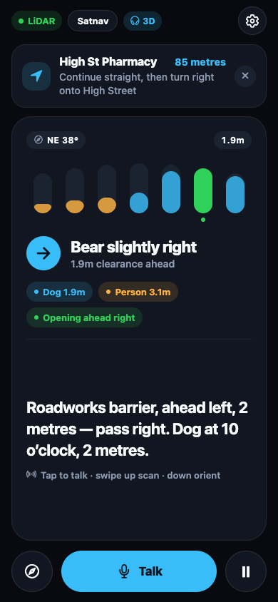
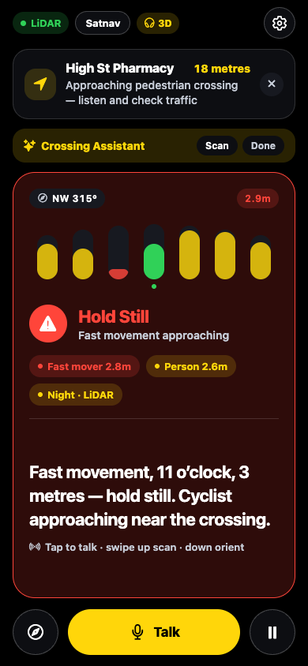
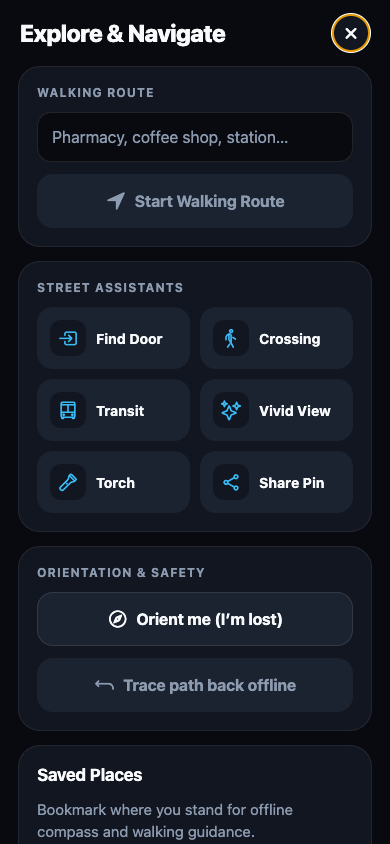
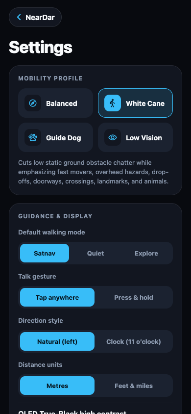

# NearDar

**An eyes-free, on-device voice, haptic, and 3D spatial audio walking satnav built for blind and visually impaired people.**


NearDar turns an iPhone with LiDAR into a live walking companion you can follow by touch and sound and talk to naturally—without looking at the screen. It combines **turn-by-turn outdoor walking directions**, **continuous local LiDAR obstacle and velocity sensing**, **CoreHaptics steering and proximity radar**, **3D binaural headphone beacons**, and **local TensorFold Mobile (`LFM3-VL-2B` on Apple Metal)** vision and conversation, all running on your device.

[Screenshots](#screenshots) · [Features](#features) · [Eyes-free gestures & voice commands](#eyes-free-gestures--voice-commands) · [Architecture](#architecture) · [Build NearDar](#build-neardar)

---

## Screenshots

<table>
  <tr>
    <td align="center" valign="top" width="25%">
      
      <br />
      <strong>Live LiDAR Satnav</strong><br />
      <sub>Curved 7-sector sonar arc, micro-detour steering, and live animal/opening badges</sub>
    </td>
    <td align="center" valign="top" width="25%">
      
      <br />
      <strong>OLED True-Black Alert</strong><br />
      <sub>Fast-mover hold-still alert, Crossing Assistant, and 0-lux Night LiDAR badge</sub>
    </td>
    <td align="center" valign="top" width="25%">
      
      <br />
      <strong>Street Assistants</strong><br />
      <sub>One-tap Find Door, Crossing, Transit, Vivid View, Torch, Share Pin &amp; offline return</sub>
    </td>
    <td align="center" valign="top" width="25%">
      
      <br />
      <strong>Mobility Profiles</strong><br />
      <sub>Balanced, White Cane, Guide Dog &amp; Low Vision presets plus clock-face &amp; unit controls</sub>
    </td>
  </tr>
</table>

<sub>Mobile UI previews captured at 390×844 using simulated LiDAR depth and walking-route telemetry.</sub>

---

## Features

### Unified Walking Satnav & Offline Resilience
- **Turn-by-turn outdoor walking routes:** Native iOS `MapKit` walking directions and place search paired with `CoreLocation` GPS and drift-free `ARKit` `.gravityAndHeading` true-north compass.
- **Hands-free pocket satnav & earbud controls:** Background `location` + `audio` modes keep spoken turns, 3D HRTF headphone beacons, and Lock Screen controls active while your phone is locked in your pocket. Trigger NearDar hands-free via AirPods stem or earbud media buttons (**click once** to talk, **double-click** to scan ahead, **triple-click** to orient yourself).
- **Macro + micro steering fusion:** Follows your outdoor walking route and automatically blends into a gentle micro-detour when LiDAR detects an obstacle blocking the centre of the pavement with open space to the left or right.
- **Works offline:** Persists saved places, cached walking routes, indoor relative spatial waypoints, direct compass/haptic beacons, and an automatic **breadcrumb return path** (*"Take me back"*).

### Real-Time Street Hazards, Perception Pro & Non-LiDAR Reach
- **7-sector LiDAR corridor & vertical hazards:** Continuously maps shoulder-width clearance across `-45°` to `+45°` ahead, alerting early for **head-height overhangs**, **step-downs**, **drop-offs**, **step-ups**, and **blocked paths**.
- **Fast-moving hazard detection (pushbikes, e-scooters, runners):** Multi-frame world-compensated `ApproachTracker` subtracts your own walking speed along every LiDAR sector ray and ignores camera pans—flagging approaching fast movers up to `4.3 m` away (`"Fast movement, 11 o'clock, 3 metres — hold still"`) while ignoring static walls you walk toward and de-escalating people walking away.
- **Instant dog, cat & people awareness:** Runs Apple Vision `VNRecognizeAnimalsRequest` and `VNDetectHumanRectanglesRequest` together on the Neural Engine (~2 Hz), fused with live LiDAR depth to call out nearby **dogs, cats, people, and crowds** with distance and direction.
- **Thermal & battery governor:** Dynamically adapts polling cadence when stationary or warm (`nominal → fair → serious → critical`) and sheds ambient VLM chatter before battery/thermals degrade while keeping P0 LiDAR + CoreHaptics 100% live.
- **Night & low-light awareness + adaptive torch:** Samples live Y-plane luma (`good | dim | dark`), warns honestly when camera visibility is dark while keeping 0-lux LiDAR protection active, and offers manual or automatic low-light torch assist for reading doors and signs.
- **Non-LiDAR iPhone & Android parity:** Non-LiDAR iPhones fall back to ARKit `rawFeaturePoints` + visual height-prior corridor estimation; Android gets full Kotlin `CorridorAnalyzer`, `ApproachTracker`, `LightAnalyzer`, torch control, and 16-cue continuous `VibrationEffect` waveform haptics.
- **Lanyard / chest-mount calibration & automatic standby:** Switch between **Handheld** and **Chest Lanyard** (`+14°` pitch compensation) carry modes. Lowering the phone or covering the lens smoothly enters standby while keeping GPS and compass guidance active.

### Street Assistants, Mobility Profiles & Everyday Companion
- **Personal Mobility Profiles:** One-tap O&M presets for **Balanced**, **White Cane** (suppresses routine low ground chatter the cane already sweeps), **Guide Dog Handler** (lets your dog route around routine static obstacles while emphasizing signs, doors, crossings, and fast movers), and **Low Vision** (enables OLED True-Black high-contrast HUD and step-edge emphasis).
- **Last-20m Door Finder:** Automatically suggests entrance assistance within `25 m` of your destination—fusing LiDAR openings, ARKit door meshes, OCR shopfront text, and TensorFold vision to report door location, push/pull/automatic type, handle side, and entrance steps.
- **Pedestrian Crossing Assistant:** Dedicated crossing check for tactile paving, dropped kerbs, push-button poles, crossing markings, and visible signals/vehicles—with strict safety guardrails that never claim a road is safe to cross.
- **Public Transit & Bus Watcher:** Instant zero-VLM OCR route matcher (*"Watch for bus 73"*) that rejects prices/years/phone numbers, plus departure board, platform-edge, and carriage door/seat assistance.
- **Vivid Scene & Guided Find:** Ask *"Describe the view"* for 3–4 rich atmospheric sentences, or *"Help me find oat milk"*, *"Check the expiry date"*, or *"What banknote is this?"*.
- **Trusted / Emergency Contact Handoff:** Save a trusted contact in Settings and say *"Share my location"* (sends GPS coordinates, street, heading, and Apple Maps / OpenStreetMap links) or *"Call my emergency contact"*.
- **Metric & Imperial Units + Screen Curtain:** Switch between **Metres** and **Feet & Miles**, Natural vs. **Clock-Face (`11 o'clock`)** phrasing, **OLED True-Black high contrast**, and a zero-glare **Screen Curtain** blackout overlay that keeps all touch gestures active.

### On-Device TensorFold Mobile Vision & Proactive Street Narrator
- **Local TensorFold Mobile (`LFM3-VL-2B-MLX-4bit` on Metal):** Compiled locally from [`ashhart/TensorFold`](https://github.com/ashhart/TensorFold) via Zig `0.17` into a native iOS `XCFramework` (~1.5 GB one-time on-device model download). Vision, scene understanding, and multi-turn conversation run 100% locally with sentence-level streaming TTS (with automatic LiteRT-LM fallback on non-Metal Android devices).
- **Proactive street & roadworks narrator:** Non-blocking background TensorFold checks (instantly cancelled on any tap or urgent hazard) identify unnamed blocking obstacles—**roadworks barriers, cones, scaffolding, pushbikes, e-scooters, parked cars, wheelie bins, A-board signs, bollards, pushchairs, puddles, and overhanging branches**—give **crossing/kerb lookaheads** before upcoming turns, and narrate passing shops, cafes, bus stops, and doorways only when you move or turn.

### Continuous CoreHaptics, 3D Spatial Audio & O&M Speech Arbitration
- **Continuous tactile steering & radar:** Native `CoreHaptics` loop provides a gentle "Follow the Beat" pulse when aligned on-course or down an open corridor, plus a parking-sensor proximity radar that quickens below `2.2 m`.
- **Distinct tactile & 3D HRTF cues:** Synthesized binaural audio (`AVAudioEngine` + `.HRTFHQ`) and custom haptic signatures distinguish **fast movers** (4-pulse shudder + directional rising sweep), **head hazards** (elevated chime), **drop-offs** (low descending tone), **left/right turns**, **dogs/people** (soft directional presence tap), **openings**, and **arrival**.
- **4-tier O&M speech priority arbitrator:** Strictly orders spoken output (`P0 Critical` > `P1 Navigation` > `P2 Interactive` > `P3 Ambient`) so life-safety alerts preempt ambient narration even while the mic is open, and silences chatter for 3 seconds after an urgent warning.
- **Clock-face or natural phrasing:** Switch between natural directions (`ahead left`, `to your right`) and Orientation & Mobility **clock-face bearings** (`11 o'clock`, `2 o'clock`) in Settings.

### Eyes-Free UX, VoiceOver Harmony & Low-Vision HUD
- **Full-screen gesture canvas:** Tap anywhere to talk with instant barge-in (or select press-and-hold in Settings), zero tiny buttons required.
- **Low-vision HUD & OLED True-Black mode:** High-contrast 7-sector clearance bars, directional steering arrow, live entity badges (`Fast mover`, `Dog`, `Person`, `Opening`, `Standby`), and a pure `#000000` / `#FFFFFF` / `#FFE600` **OLED True-Black** theme to eliminate glare.
- **VoiceOver first:** The radar visual is cleanly hidden from VoiceOver (`accessibilityElementsHidden`) while the canvas exposes one crisp unified summary and custom rotor actions (*Talk*, *Scan ahead*, *Orient me*, *Switch mode*, *Pause/Resume*).

---

## Eyes-free gestures & voice commands

| Gesture on main screen | Action |
| --- | --- |
| **Tap anywhere** *(or press & hold)* | Talk to NearDar (instant barge-in stops current speech) |
| **Swipe Up** | Instant TensorFold scan ahead (zero speech needed) |
| **Swipe Down** | Calm orientation briefing: street, compass heading & surroundings |
| **Swipe Left / Right** | Cycle mode: **Full Satnav** → **Quiet Haptics** → **Explore** |
| **Double-Tap** *(or VoiceOver Magic Tap)* | Pause / resume sensors and guidance |

### Example voice commands
- **Navigation & indoor waypoints:** *"Take me to the nearest pharmacy"*, *"Take me home"*, *"Take me back"*, *"Save this spot as Home"*, *"Remember this room as kitchen"*, *"Guide me to the kitchen"*, *"How far left?"*, *"Cancel route"*.
- **Street assistants:** *"Find the door"*, *"Help me cross"*, *"Find the crossing button"*, *"Watch for bus 73"*, *"Transit mode"*, *"Describe the view"*, *"Help me find oat milk"*, *"Check the expiry date"*, *"What banknote is this?"*.
- **Calm disorientation & safety:** *"I'm lost"*, *"Orient me"*, *"Share my location"*, *"Call my emergency contact"*.
- **Profiles, lighting & display:** *"White cane profile"*, *"Guide dog mode"*, *"Low vision mode"*, *"Turn on the torch"*, *"Screen curtain on"*, *"Turn screen back on"*.
- **Live street & visual questions:** *"What's blocking the pavement?"*, *"Read that sign"*, *"Which way is open?"*, *"Where am I?"*, *"Which way am I facing?"*.
- **Mode & speech control:** *"Quiet mode"*, *"Explore mode"*, *"Full satnav mode"*, *"Repeat"*, *"Stop talking"*, *"Pause"*.

---

## Privacy & mobility safety

- **100% on-device sensing & AI:** Camera frames, LiDAR depth maps, TensorFold vision inference, Apple Vision detection, speech recognition, haptics, and 3D spatial audio stay entirely on your phone. Temporary capture images are deleted immediately after inference.
- **Minimal network boundary:** Network access is used only when searching new addresses or fetching fresh online walking routes; cached routes, saved places, compass beacons, breadcrumb return paths, and all visual AI work offline.
- **Keep your ears open to the street:** NearDar is designed to work alongside a **white cane, guide dog, and Orientation & Mobility training**. Use bone-conduction headphones or Transparency mode outdoors—never noise cancellation—and never rely solely on camera output to judge traffic or crossings.

---

## Architecture

| Module / Directory | Role |
| --- | --- |
| `engine/` & `modules/tensorfold-engine/` | Local **TensorFold Mobile** Zig `0.17` Metal engine (`LFM3-VL-2B-MLX-4bit`), `XCFramework` build, and Swift Expo bridge with RGB pixel input & streaming tokens |
| `modules/tensorfold-perception/` | ARKit LiDAR 7-sector `CorridorAnalyzer`, `ApproachTracker` velocity estimator, vertical hazards, doorway openings, standby detection, and Apple Vision human/animal/OCR fusion |
| `modules/tensorfold-haptics/` | Native `CoreHaptics` continuous compass-lock / proximity radar timer and semantic tactile cues |
| `modules/tensorfold-voice/` | On-device `SFSpeechRecognizer`, `AVSpeechSynthesizer`, and `AVAudioEngine` 3D HRTF `SpatialAudioEngine` |
| `modules/tensorfold-navigation/` | Native `CoreLocation` GPS/heading and `MapKit` walking directions & place search (with `expo-location` fallback) |
| `modules/tensorfold-vision/` | LiteRT-LM fallback vision engine for non-Metal platforms (Android) |
| `src/lib/navigation/` & `src/lib/satnav/` | Route tracker, offline cache/saved places/breadcrumbs, macro+micro steering fusion, 4-tier `SpeechArbitrator`, proactive `StreetNarrator`, intent parser, and `SatnavProvider` |
| `src/app/` & `src/components/` | Eyes-free gesture guide canvas, `RadarHud`, OLED high-contrast theme, Settings, Setup, and TensorFold model manager |

---

## Build NearDar

### Prerequisites
- Git, Node.js, Bun, and the Zig version pinned in `vendor/TensorFold/.zig-version` (currently Zig `0.17.0`).
- **iOS (recommended — LiDAR iPhone):** macOS, Xcode, and CocoaPods.
- **Android:** Android SDK (`platform-tools` / `adb` on `PATH`) and JDK 17.

### Setup & Verification

```sh
bun install --frozen-lockfile
./scripts/bootstrap-engine.sh
cat vendor/TensorFold/.zig-version

# Run TypeScript, ESLint, and 119 Bun unit + street-replay benchmark tests
bun run verify

# Run native macOS Swift unit tests for LiDAR corridor, velocity, doorways & standby
sh scripts/test-ios-perception.sh
```

### Build & Run on iPhone (TensorFold Mobile + LiDAR)

Build the native iOS `TensorFoldMobile.xcframework` from your local TensorFold checkout, then connect a LiDAR iPhone and run:

```sh
node scripts/engine/build-mobile.mjs --ios
bun run ios
```

> If `zig` is installed outside default `PATH`, pass `ZIG=/path/to/zig node scripts/engine/build-mobile.mjs --ios`. `bun run ios` also ensures the pinned LiteRT-LM fallback artifact is verified before launching Xcode/Expo on device.

### Build & Run on Android

Set `ANDROID_HOME` (or `ANDROID_SDK_ROOT`) and connect an Android device or emulator:

```sh
bun run android
```

To build a standalone release APK after `bun run engine:android` and `bunx expo prebuild --platform android`, run `./android/gradlew -p android :app:assembleRelease`. Run `bun run web` for a browser preview of the interface.

---

[Visual model and build details](modules/tensorfold-vision/README.md) · [LiDAR validation](docs/lidar-validation.md) · [Wearable development notes](docs/wearables.md) · [Third-party notices](modules/tensorfold-vision/THIRD_PARTY_NOTICES.txt)
